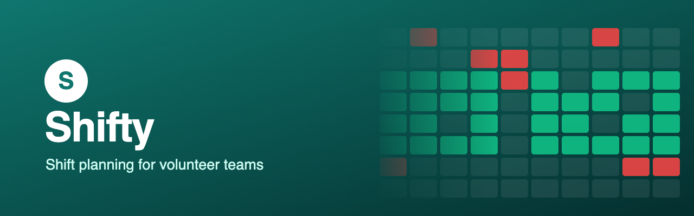
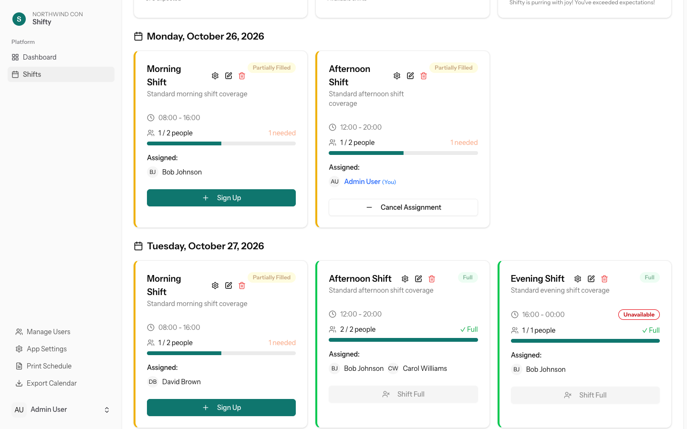
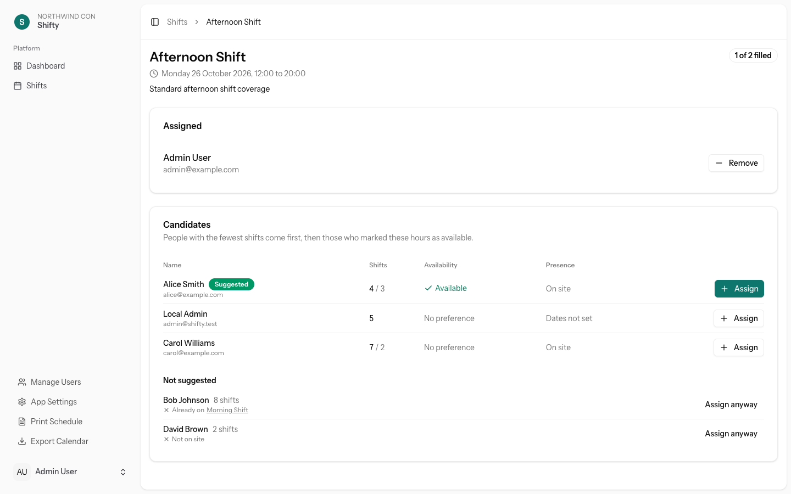
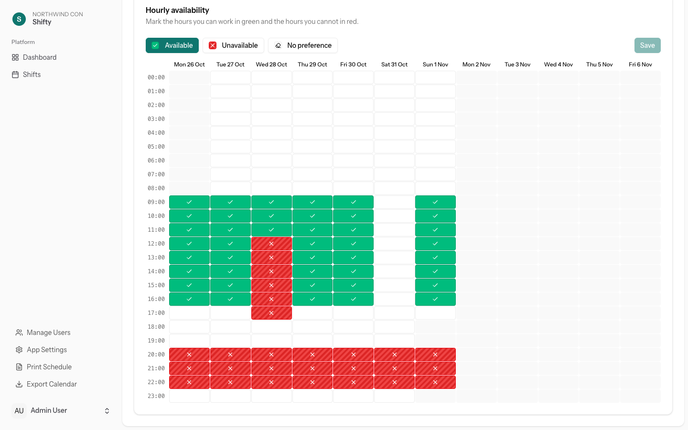
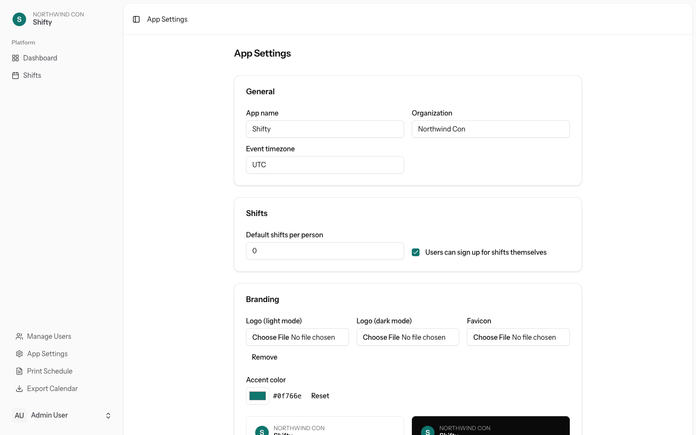

<p align="center">
  
</p>

<p align="center">
  <a href="https://github.com/Thiritin/shifty/actions/workflows/docker.yml"></a>
  <a href="https://github.com/Thiritin/shifty/releases/latest"></a>
  <a href="https://github.com/Thiritin/shifty/pkgs/container/shifty"></a>
  <a href="LICENSE"></a>
</p>

Shifty plans volunteer shifts for conventions and events. Admins create shifts, volunteers sign up for them or mark the hours they can and cannot work, and admins fill the gaps with suggestions that favour whoever has worked the least. It runs as a single container with any common database and needs no identity provider to get started.

## Features

- Volunteers sign up for shifts themselves, or admins assign everyone when self sign-up is turned off.
- Volunteers paint an hourly grid green or red to say when they are available, and see that on every shift.
- Each shift has a detail page that ranks candidates by how many shifts they already have, then by availability, and flags double bookings and people who are not on site.
- Sign in with a password, with any OpenID Connect provider, or both. Access and admin rights can follow a claim in the ID token.
- App name, logos for light and dark mode, favicon and accent colour are set in the admin area.
- A browser-based installer sets up the first admin, and a clear error page appears when the database is unreachable.
- Shifts export to any calendar app and print as a schedule.

## Screenshots

<picture>
  <source media="(prefers-color-scheme: dark)" srcset="docs/public/screenshots/shifts-dark.png">
  
</picture>

<picture>
  <source media="(prefers-color-scheme: dark)" srcset="docs/public/screenshots/shift-detail-dark.png">
  
</picture>

<picture>
  <source media="(prefers-color-scheme: dark)" srcset="docs/public/screenshots/availability-dark.png">
  
</picture>

<picture>
  <source media="(prefers-color-scheme: dark)" srcset="docs/public/screenshots/settings-dark.png">
  
</picture>

## Quick start

```bash
curl -fsSLo compose.yml https://raw.githubusercontent.com/Thiritin/shifty/main/deploy/compose/mariadb.yml
printf 'APP_URL=http://localhost:8080\nAPP_KEY=base64:%s\nDB_PASSWORD=%s\n' "$(openssl rand -base64 32)" "$(openssl rand -hex 16)" > .env
docker compose up -d --wait
docker compose logs app | grep "Setup token"
```

Open http://localhost:8080, enter the setup token and create your admin account. For PostgreSQL, Kubernetes, TLS, upgrades and backups, see [Deployment](docs/deployment.md).

## Documentation

- [Deployment](docs/deployment.md)
- [Configuration](docs/configuration.md)
- [Authentication](docs/authentication.md)
- [Development](docs/development.md)

## License

Shifty is released under the [MIT license](LICENSE). See [Contributing](CONTRIBUTING.md) to help out and [Security](SECURITY.md) to report a vulnerability.
